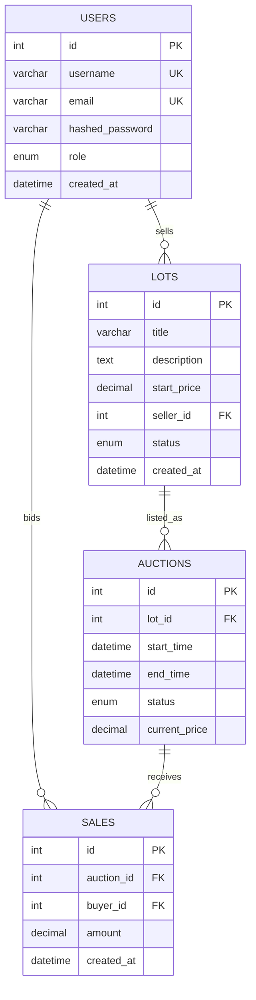

# ERD

## Связи

- один пользователь-продавец может создать несколько лотов;
- один лот может иметь несколько аукционов последовательно;
- один аукцион принимает несколько ставок;
- одна ставка принадлежит одному покупателю и одному аукциону.

## Изменения лабораторной работы №3

- `lots.condition VARCHAR(16) NOT NULL DEFAULT 'used'` (миграция `0002`). Для старых лотов
  состояние устанавливается автоматически.
- `favorite_lots` (миграция `0003`): `id` (PK), `user_id` (FK → users.id, CASCADE),
  `lot_id` (FK → lots.id, CASCADE), `created_at`. Пара `(user_id, lot_id)` уникальна.
- Связи: User 1:N FavoriteLot N:1 Lot. Отображается только избранное текущего пользователя.
